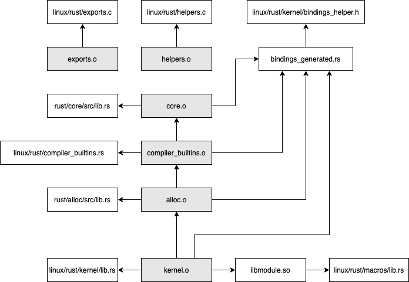

# Rust Build Processes in Kernel

This documentation tries to step over phases of building Rust support in Kernel
and linking rust files into Kernel image.

## Dependency Graph




## FFI (Foreign Function Interface)

FFI bridges Rust and C (Some C++) libraries. It provides a neat interface for
rust users to invoke c functions in a library.

## Bindgen

However, directly write FFI interface is time consuming and not long lasting. It
is better to use tools to automatically generate these bindings. For this
purpose, [bindgen] comes in.

bindgen automatically generates FFI bindings to C libraries, and give Ruster the
abilities to invoke C functions directly in Rust code. It is super convenient
and usable. For readers who have not been familiar with [bindgen], it is good
to take a quick survey.

One thing need to be noted in precedence is that [bindgen] can be both used as a
library and command line tool. For Rust in Kernel, command line tool is used.

Basically, [bindgen] takes a series of C header files in which signatures of
functions are given, then [bindgen] analyses these function signatures and
generates wrapper Rust functions on that.

[bindgen] relies on [libclang] for parsing C codes. That is why we have to
install [libclang] before compiling Rust subsystem in Kernel.

Makefile rule for generating Rust binding files is listed as below:

```
quiet_cmd_bindgen = BINDGEN $@
      cmd_bindgen = \
	$(BINDGEN) $< $(bindgen_target_flags) --rust-target 1.85 \
		--use-core --with-derive-default --ctypes-prefix ffi --no-layout-tests \
		--no-debug '.*' --enable-function-attribute-detection \
		-o $@ -- $(bindgen_c_flags_final) -DMODULE \
		$(bindgen_target_cflags) $(bindgen_target_extra)

$(obj)/bindings/bindings_generated.rs: $(src)/bindings/bindings_helper.h \
    $(src)/bindgen_parameters FORCE
	$(call if_changed_dep,bindgen)
```

Options after two dashed `--` will be passed to clang for header searching and
etc.

## Objects generated from C

Some object files are generated directly from C source files in Rust directory.
These files are generated implicitly by Kbuild's rule in that if
`foo.o` file cannot be found in any target, Kbuild will find and compile source
file named `foo.c` by default.

In Rust in Kernel, `exports.o` and `helpers/helpers.o` are such type of
generation. They are compiled from `exports.c` and `helpers/helpers.c`
respectively via Kbuild's rule.

## Objects generated from Rust

Object files other than those generated from C source are compiled from Rust
source files. Currently, these object files are: `core.o`, `compiler_builtins.o`,
`ffi.o`, `zerocopy.o`, `bindings.o`, `pin_init.o`, `kernel.o`, `uapi.o`,
`build_error.o`.
`core.o` is compiled from Rust's source code, i.e. the core component, and
`compiler_builtins.o` is the kernel's own small replacement for Rust's
`compiler_builtins`, providing the few builtins that `core` needs.

These objects are directly linked into kernel's vmlinux image via Kbuild's
`obj-$(CONFIG_RUST)` directives.

It is important to note that the size of these objects finally contributes
to the total size of vmlinux image. So, for some space critical scenarios (for
example, embedded devices), reduces the size of these object files is important.

## Always Targets

Always targets are those always built when Kbuild visits the Makefile, but not
combined into built-in.a. They are listed in `always-$(CONFIG_RUST)`, for
example:

`exports_core_generated.h`, `exports_helpers_generated.h`, `libmacros.so`,
`bindings/bindings_generated.rs`, `exports_bindings_generated.h`,
`exports_kernel_generated.h`.

# Build Kernel Module

Like build normal C kernel modules, rust modules utilise symbols exported by
kernel source. For rust, it is symbols that are exported by rust subsystem.

## Evolution

- The `bindgen` command used to pass `--ctypes-prefix c_types`,
  `--size_t-is-usize` and a list of `--opaque-type` options. Now C types are
  taken from the `ffi` crate, `size_t` maps to `usize` by default, and the
  opaque types are listed in `rust/bindgen_parameters`.
- The C helpers used to live in a single `rust/helpers.c`. They are split into
  files in `rust/helpers/` and included by `rust/helpers/helpers.c`.
- `alloc.o` and `exports_alloc_generated.h` used to be built. They are gone
  together with the `alloc` crate.
- The generated files used to be extra targets (`extra-$(CONFIG_RUST)`). They
  are always targets now.

[bindgen]: https://github.com/rust-lang/rust-bindgen
[libclang]: https://clang.llvm.org/docs/Tooling.html#libclang
